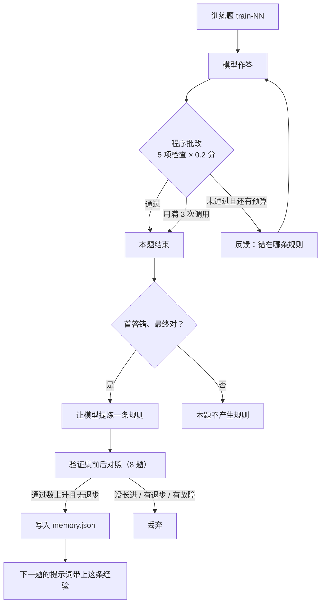

# ModelRouter + RSL

在课程框架 [ModelRouterCourse](https://github.com/NewYearEve-Godsheep/ModelRouterCourse) 的基础上，加入 **RSL（Recursive Self-Learning，递归自我学习）**。

一句话概括：

> 模型作答 → 程序批改 → 有限轮修订 → 提炼规则 → 验证入库 → 下一题带着经验再作答。

这里的"学习"不是训练模型，而是**积累一份会自我迭代的经验**。

---

## 1. 新增内容


| 层 | 文件 | 职责 |
|---|---|---|
| 学习核心 | `app/core/rsl.py` | 数据集、判分器、修订循环、规则提炼与验证、经验落盘 |
| 接入层 | `app/api/rsl.py` | 复用 ModelRouter 的鉴权 / 模型权限 / Provider，暴露 `/v1/rsl/*` |
| 运行入口 | `homework.py` | `demo` / `serve` / `learn` / `evaluate` 四个命令 |

### 配置约定

1. **不改模型权重**。没有微调、没有训练脚本，产物只有 `memory.json` 里的几条文本规则。
2. **不学习模型路由**。题目由调用方指定的 routing key 作答，走不走级联、用哪个 Provider 仍由 ModelRouter 决定。RSL 不参与选模型，也不搜索候选模型。
3. **不请模型给自己打分**。标准答案由 Python 按题目条件直接算出，判分器只比对最终 JSON。
4. **三个划分严格隔离**。训练题可以带标签反馈、可以产生规则；验证题每题只答一次、只决定规则去留；测试题不给任何标准答案数值、不改经验，只做最终对照。

---

## 2. 文件清单

新增：

| 文件 | 说明 |
|---|---|
| `app/core/rsl.py` | RSL 核心，约 480 行，全部逻辑集中在这里，便于对照阅读 |
| `app/api/rsl.py` | FastAPI 路由 `/v1/rsl/*` |
| `homework.py` | 唯一入口：离线演示、启动服务、学习、评测 |
| `tests/test_rsl.py` | 18 项离线测试，不联网 |
| `config/providers.yaml` | 把 `HOMEWORK_MODEL` 暴露成 routing key `homework` |
| `requirements.txt` | 依赖清单 |
| `results/README.md` | 实验记录规范 |

修改：

| 文件 | 改动 |
|---|---|
| `app/main.py` | 注册 `rsl` 路由；启动时初始化 `Store`；`/health` 增加 `features.rsl` |
| `.env.example` | 改为 internal 模式的本地配置模板 |
| `.gitignore` | 排除 `results/private/`、`.venv/` 等运行期产物 |
| `README.md` | 本文件 |

---

## 3. RSL 是怎么跑的



### 3.1 题目与判分

任务是问题处理：按 `active` / `region` / `qty` 三个条件筛选，按 `qty` 降序、同 `qty` 按 `id` 升序排列，输出 `ids`、`count`、`total`。

数据集由固定种子生成，`orders-v1-20261022` 版本下永远是同一批题：

| 划分 | 题量 | 用途 |
|---|---:|---|
| train | 12 | 允许带标签反馈，允许提炼规则 |
| validation | 8 | 每题只答一次，只决定规则去留 |
| test | 20 | 不泄答案、不改经验，最终对照 |

判分器有 5 项检查，每项 0.2 分：JSON 合法、字段合法（只允许三个字段且类型正确）、`ids` 对、`count` 对、`total` 对。全部命中才算通过。

几个刻意从严的地方：

- **只认末尾唯一的 `json` 代码块**。允许模型先写计算过程（这也是它在真实场景下的自然习惯），但代码块之后不能有文字、不能有两个代码块、不能有重复字段。
- **布尔值不算整数**。`{"count": true}` 直接判字段不合法。
- **不执行模型写的计算过程**。过程只供模型自己复核，判分只看最终对象，避免"过程对了结果错了"被算成通过。

### 3.2 修订循环

`refine()` 是整个过程的心脏：

- 最多 3 次调用（首答 + 2 次修订），可以通过 `max_calls` 收紧；
- 每次修订都**接着上一轮的完整对话**继续，模型能看到自己上一版答案和具体错误，而不是重新开一次；
- **保留得分最高的那一轮**，防止越改越差；
- 一旦通过立即停止，不浪费调用。

反馈内容按划分区分，这是防作弊的关键：

| 划分 | 反馈内容 |
|---|---|
| train | 错误类别 + **带标签的当前值 / 正确值** |
| validation / test | 只有错误类别，**绝不出现标准答案数值** |

所以训练阶段的"改对了"属于带标签训练，不能当作模型独立解决问题的能力。

### 3.3 提炼规则

只有"首答错、修订后对"的样本才值得提炼——首答就对说明不需要新经验，改也改不对说明这条轨迹没有可复用的东西。

提炼出的规则还要过硬校验：

- 长度 1–240 字符；
- **不含任何数字**（数字往往意味着把某道题的答案数值抄进来了）；
- 不与已有规则重复；
- 经验库最多 5 条。

### 3.4 验证准入

新规则必须先在 8 道验证题上做前后对照：同一批题，分别用「旧经验」和「旧经验 + 新规则」各答一次，每题只答一次。

入库要同时满足三条：

1. 8 道题全部跑完（有接口故障就作废，不能拿残缺数据下结论）；
2. 没有任何一道题从"对"变成"错"；
3. 通过数**严格增加**。

"没长进"和"长进但退步"都拒绝。经验库只收严格更优的规则——这是防止"越学越差"的唯一闸门。

### 3.5 三组对照

测试集上同时测三组，共用同一个首答，避免重复调用带来的随机差异：

| 组 | 做法 | 回答什么 |
|---|---|---|
| `baseline` | 直接回答一次 | 模型原始水平 |
| `feedback` | 反馈修正，最多 3 次 | 自我纠错带来多少提升 |
| `memory_single` | 带上经验只答一次 | 经验能否替代多轮反馈 |

经验为空时 `memory_single` 直接复用基线并标记 `shared_with_baseline`，**不把同一份答案说成两组独立结果**。

---

## 4. 接口

所有接口都需要 `Authorization: Bearer <ROUTER_INTERNAL_API_KEY>`，鉴权和模型权限与 `/v1/chat/completions` 完全一致。

| 方法 | 路径 | 作用 |
|---|---|---|
| GET | `/v1/rsl/tasks` | 40 道题（不含标准答案） |
| GET | `/v1/rsl/memory?model=homework` | 当前身份 + 当前模型下的经验规则 |
| GET | `/v1/rsl/runs?model=homework&limit=20` | 最近的运行记录摘要 |
| POST | `/v1/rsl/run` | 跑一道题 |

```json
{
  "task_id": "train-01",
  "model": "homework",
  "mode": "learn",
  "use_memory": true
}
```

`mode` 四种取值：

- `single`：带经验只答一次；
- `feedback`：首答 + 最多 2 次修订（默认）；
- `learn`：训练题专用，作答 → 提炼 → 验证 → 可能入库；
- `compare`：测试题专用，一次返回三组对照。

对测试题调 `learn` 会返回 422；模型不在 routing_profile 允许范围内会返回 403。


---

## 5. 目录结构

```
homework2/
├── app/
│   ├── api/
│   │   ├── rsl.py              ← 新增：RSL 接口
│   │   ├── chat.py                基础：OpenAI 兼容入口
│   │   └── admin/                 基础：管理接口
│   ├── core/
│   │   ├── rsl.py              ← 新增：RSL 核心
│   │   ├── router.py              基础：模型路由
│   │   ├── cascade.py             基础：级联
│   │   └── ...                    基础：鉴权、策略、数据库、健康度
│   ├── providers/                 基础：OpenAI / Anthropic / DeepSeek
│   └── main.py                 ← 修改：挂载 RSL
├── config/providers.yaml       ← 新增
├── docs/ModelRouter-README.md     原版框架说明
├── results/
│   ├── README.md               ← 新增：实验记录规范
│   └── offline-demo.json          离线演示产物
├── tests/test_rsl.py           ← 新增：18 项测试
├── homework.py                 ← 新增：运行入口
├── requirements.txt            ← 新增
├── .env.example                ← 修改
└── README.md                   ← 本文件
```

---

## 6. 快速开始

需要 Python 3.10+（本次在 3.13.12 / Windows 11 上验证），以及一个可用的模型服务。

```powershell
cd homework2
python -m venv .venv
.\.venv\Scripts\python.exe -m pip install -r requirements.txt
Copy-Item .env.example .env
```

编辑 `.env`：

- `ROUTER_INTERNAL_API_KEY` 换成自己的口令；
- `OPENAI_BASE_URL` / `OPENAI_KEY_1` / `HOMEWORK_MODEL` 按模型服务填。

本机 Ollama 的默认地址是 `http://127.0.0.1:11434/v1`，密钥位置随便填（如 `ollama`）。付费平台按其文档填写地址和真实密钥。**不要提交 `.env`。**

如果本机没有模型，可以先跑离线演示（不需要网络，也不需要密钥）：

```powershell
.\.venv\Scripts\python.exe homework.py demo
.\.venv\Scripts\python.exe -m pytest -q
```

有模型服务时，先启动路由服务并保持运行：

```powershell
.\.venv\Scripts\python.exe homework.py serve
```

另开一个终端，依次执行：

```powershell
.\.venv\Scripts\python.exe homework.py learn
.\.venv\Scripts\python.exe homework.py evaluate
```

服务地址 `http://127.0.0.1:8000`，接口文档在 `/docs`。结果写到 `results/learn-<时间戳>.json`、`results/evaluate-<时间戳>.json`，评测结束还会额外生成 `results/summary-<时间戳>.md`（一张可以直接贴进 README 的表格）。

要完全重做实验：把 `.env` 里的 `ROUTER_DB` 和 `RSL_OUTPUT` 改成新的文件 / 目录，再从空的 `memory.json` 开始。换模型配置也必须换数据库。

---

## 7. 离线演示

`homework.py demo` 用一个假模型把完整闭环跑一遍。假模型的规则是：提示词里有经验、或已经进入修订轮就答对，否则把 `total` 算错。这样"经验是否有效"完全由提示词内容决定，机制能被稳定复现。

实际输出（本次运行）：

```
【1】单题修订：首答算错金额，程序指出错误，模型在第二轮改对
  第 0 轮：{"ids": ["R00", "R05", "R07", "R11", "R10"], "count": 5, "total": -1}
    批改 score=0.8 passed=False feedback=['total 有误：只对入选订单逐项计算 qty×price，再求和。']
  第 1 轮：{"ids": ["R00", "R05", "R07", "R11", "R10"], "count": 5, "total": 2353}
    批改 score=1.0 passed=True feedback=[]

【2】学习：从这次成功修订里提炼规则，并用 8 道验证题做前后对照
  候选规则：先逐行筛选三个条件，再排序，最后逐项核算金额。
  验证通过数 0/8 → 8/8，无退步=True，入库=True（accepted）
  当前经验库（1 条）：['先逐行筛选三个条件，再排序，最后逐项核算金额。']

【3】对照：同一道测试题，直接回答 / 反馈修正 / 带经验单次回答
  直接回答     通过=False  调用 1 次
  反馈修正     通过=True   调用 2 次
  带经验单次   通过=True   调用 1 次
```

**这些数字是假模型的，不能当实验结果。** 它的价值在于：在没有模型、没有密钥、没有网络的情况下，也能确认判分器、修订预算、规则准入、经验隔离这几条链路是通的。


---

## 8. 测试

```powershell
.\.venv\Scripts\python.exe -m pytest -q
# 18 passed
```

全部离线，不联网、不需要模型。覆盖：

| 层 | 测的点 |
|---|---|
| 判分器 | 已知答案、重复字段、布尔冒充整数、多余字段、代码块提取边界 |
| 数据集 | 固定可复现、40 题互不重复、划分 12/8/20、每题至少 2 条入选 |
| 修订循环 | 预算耗尽、保留最高分、反馈不泄题、轮次是追加而非重开、上游异常不算答错 |
| 学习循环 | 只在验证通过时入库、退步/没长进/故障均拒绝、测试题禁止学习、数字规则被拒、经验库上限 |
| 接入层 | 真实 `app.main` 启动 → 401 鉴权 → 403 模型权限 → 422 划分校验 → Provider 转发（MockTransport，不出网）→ 重启后经验仍在 → 按用户隔离 |

最后一项用的是真实 ModelRouter 的启动和鉴权链路，只把最外层的 HTTP 换成了 `MockTransport`，所以它不是"测了个假的"。

---

## 9. 局限

- 数据是小规模合成订单题，不能代表通用能力；任务形式单一，规则容易退化成复述题面。
- 验证集只有 8 道，且被反复用于筛选规则，存在过拟合风险；通过数 +1 的差异很可能只是噪声，所以准入条件写成了"严格增加 + 无退步"这种保守形式，宁可少收规则。
- 计算过程只给模型自己看，程序不执行它，可能出现"过程对、结论错"；判分只看最终对象。
- 经验是纯文本，靠提示词生效，模型规模太小或指令跟随能力弱时可能完全无效——这也是为什么必须用验证集把关，而不是"总结出来就存"。
- 单进程运行，经验库的串行锁只在单进程内有效；`serve` 里固定 `workers=1`。
- 一轮完整学习最坏约 12×(3+2×8)=228 次调用，测试最多 20×4=80 次，付费接口会产生费用。

---

## 10. 常见问题

**`AllKeysFailedError`**：单 Key 每分钟调用数打满了。RSL 一道题最多 3 次调用，一轮学习 + 评测很容易上百次，基础框架默认的 60 rpm 不够。`config/providers.yaml` 里已经把 `rpm` 放到 600（本地 Ollama 无配额）；接付费接口时按套餐调小，或者拆成多个 Key。

**`FileNotFoundError: config/providers.yaml`**：必须从 `homework2/` 目录启动，`homework.py` 会自己 `chdir`，但直接用 `uvicorn app.main:app` 时要保证工作目录正确。

**请求超时 / 代理报错**：Windows 上系统 HTTP 代理可能把 `127.0.0.1` 也转发出去。`homework.py` 已经设置 `NO_PROXY` 且 `trust_env=False`；自己写脚本调接口时注意同样处理。

---

## 11. 参考

- 基础框架：[ModelRouterCourse](https://github.com/NewYearEve-Godsheep/ModelRouterCourse)
- 课程提供的递归自我改进资料
